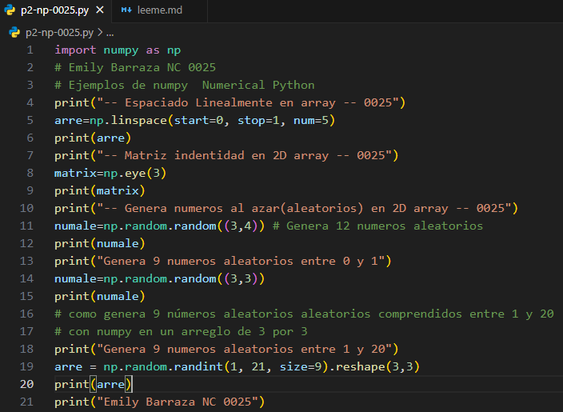
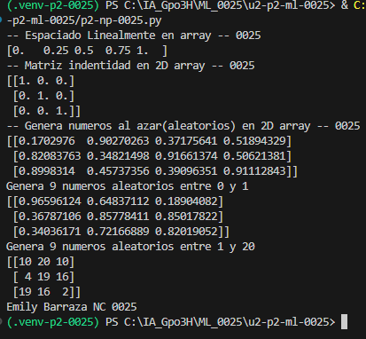

- `start=0`: Valor inicial de la secuencia.
- `stop=1`: Valor final de la secuencia.
- `num=5`: Cantidad de valores que se generan entre el inicio y el final, incluyendo ambos extremos.

## que es np.linspace
`linspace()` es una función de NumPy que genera una cantidad determinada de números distribuidos uniformemente entre un valor inicial y uno final.

## código

## resultado
